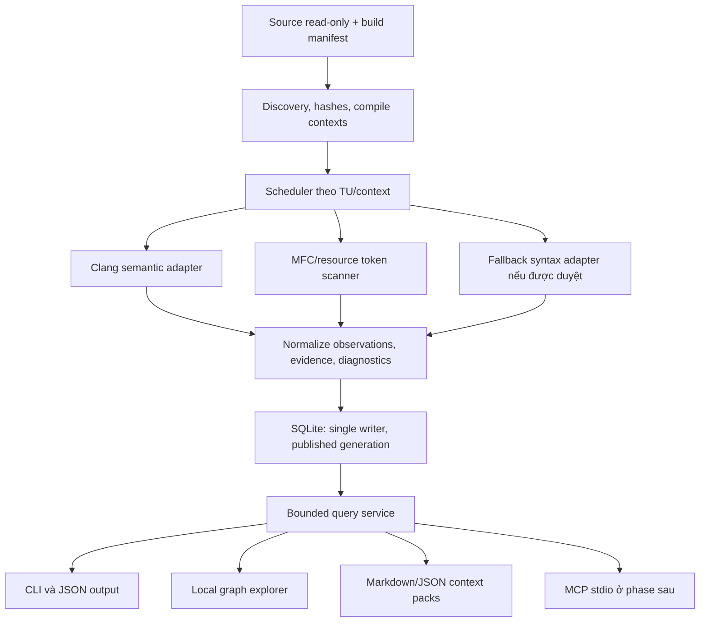

# Legacy C++/MFC Source Code Intelligence — Research & Implementation Plan

Ngày nghiên cứu: 28/10/2026. Trạng thái: đề xuất thiết kế, chưa implementation.

Tài liệu trả lời yêu cầu nghiên cứu cho repository C++/MFC khoảng 1–5 triệu LoC trong môi trường enterprise Windows hạn chế cài đặt. Hiện chưa có source doanh nghiệp, thông tin toolchain hay danh sách dependency được phê duyệt. Vì vậy, các lựa chọn dưới đây là đề xuất có điều kiện; số đo hiệu năng và độ chính xác chưa được xác nhận thực nghiệm.

## 1. Kết luận và quyết định đề xuất

**Khả thi nếu chấp nhận một semantic parser được phê duyệt và chuẩn bị đúng thông tin build.** Không cần cloud, database server, Node.js, npm, React, Electron, Docker hay license phần mềm mới.

Stack ưu tiên:

- Python 64-bit đã được công ty chấp thuận; dùng Standard Library cho orchestration, CLI, hashing, SQLite và export.
- SQLite làm persistent index; đọc/ghi trên ổ local.
- Clang/libclang với Python binding tương thích làm semantic parser cho MVP.
- Bộ đọc token/macros MFC chuyên biệt, giữ bằng chứng từ source gốc.
- CLI trước, HTML/CSS/Vanilla JavaScript sau. Graph UI dùng SVG tự vẽ ở phạm vi nhỏ, hoặc Cytoscape.js bản đóng gói local nếu được duyệt.
- Source là read-only; index, cache, logs và context packs nằm trong thư mục output riêng.

Không nên coi zero external dependencies là mục tiêu quan trọng hơn tính đúng của call graph. Python Standard Library có thể xây dựng công cụ tra cứu cấu trúc và macro hữu ích, nhưng không cung cấp sẵn semantic parser C++. Việc tự viết bộ giải nghĩa C++ đủ tin cậy vượt xa phạm vi MVP.

| Điều kiện triển khai | Khả năng thực tế | Quyết định |
|---|---|---|
| Python + Clang/libclang được duyệt, lấy được build context | Symbol graph, direct calls, MFC mappings, context export có cơ sở ngữ nghĩa | Phương án chính |
| Python + Tree-sitter được duyệt, chưa có Clang/build context | Cấu trúc, vị trí, call expressions và mapping ở mức cú pháp | Chế độ hỗ trợ điều tra; không tuyên bố call graph đã resolve |
| Chỉ Python Standard Library | File inventory, include/macro observations, text search, export vùng source được chọn | Giảm phạm vi; chưa đáp ứng đầy đủ FR-01/FR-02 |
| Python không được phép, .NET/C++ có sẵn | Có thể chuyển orchestration/UI sang C# hoặc C++; vẫn cần giải quyết parser | Nhánh kiến trúc dự phòng, cần ước lượng lại |

“Có Visual Studio” không có nghĩa máy đã có Clang, MFC headers hay libclang DLL. Clang là thành phần tùy chọn trong Visual Studio; phải kiểm tra đúng bộ công cụ đang có. [Microsoft: Clang/LLVM trong Visual Studio](https://learn.microsoft.com/en-us/cpp/build/clang-support-msbuild?view=msvc-170)

## 2. So sánh hướng parsing

| Hướng | Đầu ra đáng tin cậy trong phạm vi phù hợp | Giới hạn với yêu cầu này | Vai trò đề xuất |
|---|---|---|---|
| Python stdlib: regex + lexer tự viết | Inventory, token spans, macro invocation nhận diện được | Không giải overload, type lookup, template, preprocessor đầy đủ; regex thuần dễ nhầm comment/string/declaration | Scanner phụ trợ rất hẹp |
| `cxxheaderparser` | Khai báo class/function trong headers phù hợp | Không có full AST; macro cần preprocessing; không giải toàn bộ function-body call graph | Không chọn làm parser chính |
| `tree-sitter` + grammar C++ | Concrete syntax tree, vùng source, cập nhật cú pháp, xử lý code không hoàn chỉnh | Không thay thế compiler semantic analysis hay build-aware preprocessing; call target phải để unresolved/candidate nếu thiếu bằng chứng | Fallback tùy chọn |
| Python + libclang | AST cursors, declaration/reference, type/signature, direct-call target trong TU parse đúng | Cần include/define/toolchain đúng; API không phơi bày toàn bộ AST/CFG/dataflow; có overhead Python | Chọn cho MVP, phải qua thử nghiệm MFC |
| C++ + Clang LibTooling | Truy cập AST chi tiết và preprocessing callbacks; mở đường cho analysis sâu | Cần LLVM development dependencies, build/phân phối native binary, quản lý tương thích version | Nâng cấp khi libclang thiếu API hoặc không đạt hiệu năng |
| `clang-cl` AST dump | Có thể dùng để khảo sát AST bằng tool có sẵn | Output lớn, phải pin/test format theo version; không chọn làm persistent format | Công cụ nghiên cứu, không mặc định là backend |
| MSVC `/P`, `/showIncludes`, `/sourceDependencies` | Preprocessed text và/hoặc dependencies ở cấp file theo compilation | Không phải API cung cấp semantic call graph hoàn chỉnh | Hỗ trợ build-context và invalidation |
| PDB/DIA, browse artifacts của Visual Studio | Bổ sung symbols/locations nếu có artifacts phù hợp | Phụ thuộc build/debug data; không thể mặc định khôi phục source-level relationships/macros đầy đủ | Để sau, không lấy làm nguồn chính |
| C#/.NET/Roslyn | Thích hợp orchestration/UI nếu .NET có sẵn | Roslyn cung cấp compiler APIs cho C#/VB, không giải bài toán parsing C++ | Không chọn làm C++ parser |

Các cơ sở kỹ thuật:

- `cxxheaderparser` tự nêu không tạo full AST và cần preprocessor cho macro. [Tài liệu dự án](https://github.com/robotpy/cxxheaderparser)
- Tree-sitter Python dùng parser và grammar riêng. Cần kiểm tra cả `ERROR` lẫn `MISSING`; có cây cú pháp không đồng nghĩa toàn bộ file được hiểu đúng. [Python bindings](https://github.com/tree-sitter/py-tree-sitter), [C++ grammar](https://github.com/tree-sitter/tree-sitter-cpp), [Query syntax](https://github.com/tree-sitter/tree-sitter/blob/master/docs/src/using-parsers/queries/1-syntax.md)
- Clang khuyến nghị libclang cho giao diện cấp cao ổn định, LibTooling khi cần kiểm soát AST sâu hơn. [Clang tooling interfaces](https://clang.llvm.org/docs/Tooling.html)
- `/sourceDependencies` ghi dependencies cấp source/header/PCH/module và có từ VS 2019 16.7. Đây là nguồn hỗ trợ tìm TU chịu ảnh hưởng khi header đổi, không phải danh sách function calls. [Microsoft reference](https://learn.microsoft.com/en-us/cpp/build/reference/sourcedependencies?view=msvc-170)
- `/P` thực hiện preprocessing và tạo line directives; macro đã bung nên cần giữ source gốc cho evidence MFC. [Microsoft preprocessing](https://learn.microsoft.com/en-us/cpp/build/reference/p-preprocess-to-a-file?view=msvc-170)
- DIA truy vấn debug information trong PDB; Roslyn nhắm C#/VB. [DIA SDK](https://learn.microsoft.com/en-us/visualstudio/debugger/debug-interface-access/debug-interface-access-sdk?view=visualstudio), [Roslyn](https://github.com/dotnet/roslyn)

### 2.1. Chiến lược đóng gói libclang

Ưu tiên bộ libclang DLL + Python bindings + resource headers tương thích đã được duyệt. Kiểm tra kiến trúc x64, version, đường dẫn tải DLL và khả năng parse MFC trên máy đích.

Gói PyPI `libclang` đóng gói bindings cùng shared library; gói `clang` là gói khác và không kèm shared library dựng sẵn. Không cài cả hai thiếu kiểm soát vì cùng cung cấp namespace Python liên quan. Khả năng có wheel đúng Windows/Python version phải được kiểm chứng trước khi chốt. [Thông tin từ nhà phát hành gói](https://pypi.org/project/libclang/)

Không suy ra “cài được qua pip” nghĩa là được policy cho phép. Bộ phân phối cần manifest version/hash/license, nguồn nội bộ và hướng dẫn offline; có thể dùng wheelhouse đã duyệt. Không tự tải dependencies ở runtime. Không giả định wheel chứa Windows SDK/MFC/MSVC headers.

### 2.2. Khi nào chuyển sang LibTooling

Chỉ chuyển nếu thử nghiệm cho thấy một trong các điều kiện: bindings thiếu thông tin call/macro bắt buộc, không phân loại được vùng lỗi an toàn, Python traversal là bottleneck đã đo, hoặc advanced dataflow cần AST/CFG không có trong libclang. Giữ interface parser ổn định để thay backend mà không viết lại SQLite/query/export.

## 3. Build context và độ khó của legacy C++/MFC

### 3.1. Đơn vị phân tích là translation unit + compile context

Translation unit (TU) là file biên dịch chính cùng headers và cấu hình tiền xử lý của lần biên dịch đó. Một `.cpp` trong hai projects hoặc hai configurations có thể tạo hai TU contexts khác nhau. Một header không có một ý nghĩa ngữ nghĩa duy nhất độc lập với TU.

Mỗi context phải ghi: project/target, Configuration/Platform, working directory, compiler/toolset version, architecture, language mode, include search order, defines/undefines, forced includes, response files, PCH setup, SDK/MFC versions và provenance của dữ liệu build.

Clang compilation database cho phép nhiều compile commands cho cùng một file. Cần giữ cả ngữ cảnh, không dùng path làm khóa duy nhất. [Compilation database specification](https://clang.llvm.org/docs/JSONCompilationDatabase.html)

Thứ tự lấy build context:

1. Import compilation manifest/compile commands từ workflow nội bộ đáng tin cậy nếu đã có.
2. Dùng MSBuild có sẵn để lấy evaluated items/properties theo từng project/configuration; đối chiếu vài compilation commands thực tế.
3. Với MSBuild 17.8+, xem xét `-getItem`/`-getProperty` không chạy targets. Đây là dữ liệu evaluation; chưa chắc bao gồm thay đổi được tạo lúc thực thi targets. [MSBuild evaluation](https://learn.microsoft.com/en-us/visualstudio/msbuild/evaluate-items-and-properties?view=vs-2022)
4. Nếu evaluation chưa đủ, import logs/manifests từ một build do đội dự án chủ động thực hiện. Nếu dùng binlog reader ngoài stdlib, khai báo dependency riêng.
5. Fallback MVP cho một module: manifest JSON thủ công gồm từng TU và flags đã được người phụ trách build xác nhận.

Đọc XML `.vcxproj` bằng stdlib chỉ dùng cho discovery và chẩn đoán. Không tự tuyên bố đã mô phỏng đầy đủ MSBuild imports, `.props`, `.targets`, conditions, item metadata, môi trường và generated sources. `.sln` xác định project và mappings cấu hình; `.vcxproj.filters` chỉ phục vụ tổ chức hiển thị.

Scanner không tự chạy build/custom targets. Các bước lấy dữ liệu qua MSBuild hoặc compiler phải được mô tả rõ và hoạt động trên project đáng tin cậy. Ưu tiên dùng manifest có sẵn; cache/output của phân tích nằm ngoài cây source. Generated headers phải có sẵn hoặc báo thiếu.

### 3.2. Các trường hợp cần xử lý riêng

| Trường hợp | Cách xử lý và giới hạn |
|---|---|
| Macro nhiều dòng, nested arguments, comments, strings | Tokenize có trạng thái và cân bằng ngoặc; không match bằng một regex duy nhất. Ghi span invocation và definition nếu biết |
| `#if`, `_DEBUG`, `_UNICODE`, flags riêng từng file | Gắn active/inactive/unknown theo context. Không hợp nhất nhánh loại trừ nhau thành một execution path |
| MSVC extensions, code compiler cũ chấp nhận | Dùng compatibility flags phù hợp; lưu diagnostics. Không che lỗi bằng cách xóa mọi macro/keyword lạ |
| PCH | Không giả định libclang đọc được PCH nhị phân MSVC. Bắt đầu từ header gốc/forced includes; Clang PCH riêng chỉ tối ưu sau benchmark |
| `#import`, COM/type libraries, generated `.tlh/.tli`, C++/CLI | Thử nghiệm riêng; có thể ngoài phạm vi parser đã chọn. Báo unsupported hoặc dùng generated artifacts đã có |
| Overloads, namespaces, typedefs, operators, constructors | Resolve bằng declaration/type information; không chọn target chỉ vì trùng tên hoặc số arguments |
| Templates | Ghi declaration và specialization/instantiation mà parser thực sự quan sát. Dependent calls chưa đủ thông tin giữ unresolved |
| Virtual calls | Ghi static target và dispatch kind; possible overrides là candidates. Không đổi static target thành khẳng định implementation chạy thực tế |
| Function pointers/callbacks | Ghi address-taking/registration; chưa chứng minh luồng giá trị thì indirect call vẫn unresolved |
| Cross-file | Nối declaration/definition bằng semantic identity trong scope thích hợp; không nối theo tên trần |
| Internal linkage, anonymous namespaces | Khóa identity có TU/file scope; không gộp các hàm `static` cùng tên ở hai files |
| Shared/global state | Bắt đầu bằng symbol references. Read/write/alias-aware dependencies để phase nâng cao; không coi mọi reference là write |
| Encodings Windows legacy | Phát hiện BOM, cấu hình encoding theo project/file; giữ raw bytes và byte offsets. Không decode với replacement rồi dùng offset sai |
| Resource files | Parse subset `.rc`, `.rc2`, `resource.h` đã công bố; lưu cả symbolic ID và giá trị chỉ khi đánh giá được trong đúng context |

Clang hỗ trợ nhiều MSVC extensions nhưng tài liệu vẫn nêu những khác biệt tương thích. Vì vậy phải làm compatibility trial trên source thật, không đảm bảo “Clang parse được mọi project build được bằng MSVC”. [MSVC compatibility](https://clang.llvm.org/docs/MSVCCompatibility.html)

### 3.3. MFC evidence model

MVP hỗ trợ `BEGIN_MESSAGE_MAP`/`END_MESSAGE_MAP`, `ON_COMMAND`, `ON_BN_CLICKED`, `ON_MESSAGE`, `ON_NOTIFY`, `ON_UPDATE_COMMAND_UI` và một tập `ON_WM_*` được liệt kê, kiểm thử cụ thể. `ON_WM_*` cần bảng ánh xạ macro → handler theo tài liệu/header của phiên bản MFC, không suy tên bằng cách tùy ý bỏ prefix.

Phase sau thêm ranges, reflected notifications, registered/thread messages, template message maps và custom wrapper macros. Macro chưa hỗ trợ vẫn được lưu thành observation với reason; không bỏ qua im lặng. Với ranges, lưu interval/symbolic bounds; không materialize hàng nghìn IDs.

Node sự kiện có identity gồm owner class, message/notification kind, resource ID/range, build context. Ví dụ thiết kế: event `COrderDlg / BN_CLICKED / IDC_SAVE` có quan hệ `handles_event` tới `COrderDlg::OnSave`, bằng chứng là vị trí macro. Resource control có thể liên kết event khi owner/resource binding đã có căn cứ.

Đây là quan hệ đăng ký xử lý, không phải direct function call. `SendMessage`/`PostMessage` tới một HWND chưa resolve không được nối chắc chắn tới handler chỉ vì ID giống nhau. Command routing MFC còn phụ thuộc đối tượng đang active và thứ tự routing. [Message-map macros](https://learn.microsoft.com/en-us/cpp/mfc/reference/message-map-macros-mfc), [MFC command routing](https://learn.microsoft.com/en-us/cpp/mfc/command-routing?view=msvc-170)

## 4. Kiến trúc tổng thể

Module boundaries dự kiến:

| Module | Trách nhiệm |
|---|---|
| `discovery` / `build_context` | Danh sách files/projects, exclusions, compile manifests, hashes |
| `parsers` | Adapter trả về observations chuẩn, không ghi DB trực tiếp |
| `mfc` / `resources` | Macro registry và resource mappings có version |
| `index` | Schema, migrations, staging, publication, incremental invalidation |
| `queries` | Search, neighbors, bounded subgraph, path, snippets |
| `context` | Chọn bằng chứng, budget, truncation, render Markdown/JSON |
| `cli` / `web` | Giao diện; dùng chung query service |
| `validation` | Fixtures, golden labels, benchmarks ở các phase triển khai |

Không đưa graph database server, vector database, embedding, LLM summarization hoặc distributed indexing vào MVP. Chỉ xem xét thêm nếu benchmark và nhu cầu thực tế chứng minh cần thiết.

## 5. Mô hình dữ liệu SQLite

Thiết kế dưới đây là logical schema, chưa phải migration SQL. MVP triển khai phần lõi phục vụ semantic parsing, MFC, queries và export; các loại quan hệ advanced có thể bổ sung sau.

| Bảng | Nội dung chính |
|---|---|
| `repositories` | ID, root mapping, source revision nếu có |
| `files` / `file_versions` | Repo-relative path, canonical identity, size, hash, encoding, byte/line mapping |
| `projects` / `build_contexts` | Project/target/config/platform, compiler/flags/environment fingerprint |
| `translation_units` | Main file + compile context; trạng thái và dependency fingerprint |
| `generations` / `parse_runs` | Parser/rule versions, thời điểm, trạng thái, diagnostics/coverage totals |
| `entities` | Symbol/class/namespace/file/event/resource; kind, name, semantic key, linkage scope |
| `symbol_occurrences` | Declaration/definition, signature, parent entity, file version, byte span, line/column |
| `observations` | Fact được parser/rule ghi nhận; owning TU/context/run, condition, extraction quality |
| `relations` | Source entity, target nullable, kind, resolution status, dispatch kind, resolution reason |
| `relation_evidence` | Relation ↔ observation, callsite/macro span, rule và parser provenance |
| `relation_candidates` | Candidate targets và căn cứ từng candidate; không lẫn với confirmed target |
| `tu_dependencies` | TU ↔ consumed file versions; include/PCH/forced-include provenance |
| `diagnostics` | Severity, parse scope, source span, missing dependency/unsupported feature |

Logical separation giữa entity và occurrence tránh nhân bản symbol chỉ vì header xuất hiện trong nhiều TU. Tuy nhiên, lưu observations và visibility theo TU/config để không đánh mất những khác biệt có thật. Quy tắc dedup phải phân biệt external/internal linkage, project/link domain, specialization và configuration-sensitive definitions.

Có thể dùng Clang USR làm thành phần semantic key cùng repo/linkage scope; không dùng raw AST pointer, display name hoặc line number làm ID bền vững. Lưu parser version và có chiến lược reindex khi identity thay đổi. Libclang cung cấp APIs cho USR và reference/declaration/definition; việc nối toàn repo vẫn là trách nhiệm của indexer. [Libclang cross-reference APIs](https://clang.llvm.org/doxygen/group__CINDEX__CURSOR__XREF.html)

### 5.1. Ý nghĩa relationship

Các loại ban đầu: `calls`, `member_of`, `inherits`, `declared_in`, `defined_in`, `handles_event`, `includes`. Sau đó: `overrides`, `registers_callback`, `references_state`, `reads_state`, `writes_state`, `may_dispatch_to`.

Mỗi relationship phải tách các chiều sau:

- `resolution_status`: `resolved`, `ambiguous`, `unresolved` — target đã nhận diện tới đâu.
- `dispatch_kind`: direct, virtual, indirect, event-registration — loại hành vi.
- `extraction_quality`: semantic, syntactic, recovered, manual — nguồn và chất lượng bằng chứng.
- `condition_state`: active, inactive, unknown trong context đang xét.
- `reason`: mã cụ thể như missing_header, dependent_template, unknown_receiver, unsupported_macro.

`resolved` có nghĩa target của fact đã được xác định trong compile context. Nó không có nghĩa lời gọi sẽ chạy ở mọi execution. Virtual static-target có thể resolved nhưng dynamic target vẫn unknown. Không dùng phần trăm confidence tùy ý thay thế các nhãn này.

Callsite unresolved vẫn lưu expression/span/caller và candidates có bằng chứng; không tạo fake function mang tên `unknown`. Declaration bên ngoài repo có thể là resolved external entity nhưng không có source body.

### 5.2. Indexes và query semantics

- B-tree theo normalized symbol name, qualified name, semantic key và file path.
- Adjacency indexes theo `(context, source, kind, status, target)` và chiều reverse `(context, target, kind, status, source)`; điều chỉnh bằng query plans/benchmark.
- Index ownership theo TU/run và reverse dependency theo file để cập nhật có giới hạn.
- FTS5 tùy chọn cho symbol tokens/documentation; kiểm tra khả năng build SQLite. Fallback exact/prefix search có index. Không mặc định substring `LIKE '%x%'` sẽ nhanh trên hàng triệu rows. [SQLite FTS5](https://sqlite.org/fts5.html)
- Caller/callee là hai hướng truy vấn cùng quan hệ, không cần lưu bản sao đối nghịch.
- Search mặc định 50 kết quả, keyset pagination; phân biệt các overload/project/context.
- Neighbors/subgraph có node/edge/hop/deadline budgets và stable ordering; trả `truncated`, lý do và continuation cursor nếu có.
- BFS/bi-directional BFS cho shortest unweighted dependency path, fetch adjacency từng batch từ SQLite. Không tải cả graph thành Python objects. Không dùng recursive query không giới hạn trên graph có cycles.
- Path mặc định lọc một build context và những relation kinds phù hợp. Nếu query đi ngược cạnh để tìm callers, kết quả vẫn giữ chiều thật của cạnh.
- Không trộn Debug với Release hay các variants mâu thuẫn. Cross-project path chỉ nối qua identity/link domain đã xác nhận; constraints chưa chứng minh tương thích phải được báo rõ.
- Có path trong dependency graph không chứng minh runtime reachability: branch conditions, object lifetime và thread state vẫn có thể chặn execution.
- Trả riêng `found`, `not_found_within_scope`, `truncated`, `incomplete_index`; không biến timeout hoặc graph thiếu dữ liệu thành khẳng định không có dependency.

## 6. Indexing, incremental updates và tính nhất quán

### 6.1. Initial indexing

1. Chốt source snapshot/worktree và contexts cần phân tích; MVP chọn một configuration/platform của một module thật.
2. Inventory files, encoding, source bytes/LoC và exclusions. Vẫn parse headers cần thiết nhưng chỉ index sâu first-party scope đã chọn; external symbols giữ metadata tối thiểu.
3. Tạo jobs theo TU/context, giới hạn workers theo RAM thực đo.
4. Parser worker giải phóng AST sau mỗi job/batch; chỉ gửi observations cần lưu qua queue có giới hạn.
5. Một writer ghi staging theo batch/transaction; không để nhiều Python workers tranh write lock.
6. Dedup, resolve declaration/definition, gắn evidence, thống kê coverage/diagnostics.
7. Publish một generation sau khi checks hoàn tất. Query thấy snapshot nhất quán; context pack ghi generation ID.

Tối ưu AST traversal ở Python phải được đo. Nếu không thể bỏ qua header subtrees an toàn hoặc overhead cursor quá cao, chuyển extraction nóng sang native adapter thay vì tăng worker vô hạn.

### 6.2. Phát hiện thay đổi

Fingerprint job gồm hash source + transitive dependencies + normalized compile arguments + relevant environment/toolchain + parser version + MFC rule version. Không chỉ nhìn mtime của `.cpp`.

| Thay đổi | Invalidation |
|---|---|
| Sửa `.cpp` riêng | Các TU contexts chứa file đó |
| Sửa header/forced include/PCH source | Reverse dependency closure tới các TU phụ thuộc |
| Sửa `.props`, `.targets`, flags, SDK, parser/rules | Re-evaluate manifests; invalidate TU contexts có fingerprint đổi |
| Xóa/rename file hoặc loại khỏi project | Xóa/retract observations thuộc jobs cũ; cập nhật callers và candidate resolution liên quan |
| Generated header xuất hiện/đổi | Invalidate consumers, kể cả jobs trước đây lỗi vì missing header |
| Thêm header làm đổi include resolution | Theo dõi include search locations; khi không xác định được ảnh hưởng thì invalidate conservative trong context/module |
| Thêm/xóa definition | Chạy lại bước resolution cho affected identity/candidates; không giữ target cũ đã mất |

mtime/size là fast prefilter. Có chế độ strict hash để bắt thay đổi giữ nguyên timestamp; lưu hash vào file versions để kiểm tra source freshness khi export. Tree-sitter incremental syntax tree, nếu dùng, chỉ là tối ưu parser; không thay thế dependency invalidation ở mức repository.

Nếu dependency graph của một TU bị thiếu do parse error, phải ghi incomplete và invalidate rộng hơn khi dependencies thay đổi. Không tuyên bố incremental chính xác khi input dependencies chưa biết đủ.

### 6.3. Atomic publication và stale data

Staging giữ observations theo parse run; chỉ chuyển generation hiện hành sau khi thay thế những jobs liên quan hoàn tất. Có thể dùng bảng mapping generation → active run cho các TU, tránh copy toàn bộ graph mỗi lần. Đây là cơ chế nhất quán nội bộ, không phải hệ thống lịch sử source vô hạn.

Khi một TU parse thất bại, giữ run cũ để tra cứu lịch sử nhưng loại khỏi graph “current verified”, hoặc hiển thị rõ stale nếu người dùng bật. Freshness là trạng thái riêng với semantic resolution. Export mặc định không trộn source mới với line ranges từ index cũ.

Kiểm tra incremental bằng cách so sánh logical graph với full rebuild trên cùng source snapshot/context/parser version; bỏ qua IDs/timestamps không mang ý nghĩa. Test kill/cancel trong lúc index và recovery để đảm bảo không có graph nửa cũ nửa mới.

SQLite WAL hỗ trợ đọc song song với writer, nhưng database WAL phải nằm trên local filesystem; checkpoint và backup phải xử lý đúng `-wal`/`-shm`. Dùng SQLite backup API cho live backup thay vì copy mỗi file `.db`. [SQLite WAL](https://sqlite.org/wal.html)

### 6.4. Quy mô 1–5 triệu LoC

LoC là chỉ báo đầu vào, không đủ dự đoán chi phí. Phải đo thêm số TU/configurations, preprocessed bytes, template density, header fan-out, symbol occurrences và callsites. Shared header có thể được parse hàng nghìn lần; nhiều configurations nhân khối lượng.

Không lưu AST toàn repo trong RAM hay dump AST JSON toàn repo làm primary storage. SQLite lưu entity/observation/evidence dạng chuẩn hóa, payload tối thiểu; source snippets đọc theo nhu cầu với kiểm tra hash hoặc lấy từ source blob đã lưu theo hash.

Ước lượng dung lượng sau pilot bằng bytes thực đo trên symbol/occurrence/relation/evidence, cộng indexes, WAL/staging và snapshot cache. Không cam kết một con số GB từ LoC. Đặt giới hạn cache, retention của generations và disk headroom trước khi chạy rộng.

## 7. Context export cho AI

### 7.1. Hợp đồng đầu vào/đầu ra

Đầu vào: seed symbol IDs hoặc source/target IDs, build context, direction, relation types, depth, allowed resolution statuses, node/edge cap, token budget, source policy và index generation.

Markdown cho người/agent đọc; JSON có versioned schema cho tích hợp. Cùng một context model sinh cả hai formats, gồm:

- Repo revision nếu có, file hashes, generation, compile context, parser/rule versions.
- Seeds, query scope, path nếu yêu cầu, traversal limits.
- Symbols/signatures, file paths, line ranges và byte spans khi cần.
- Original source snippets và adjacent type/macro/resource definitions cần để hiểu chúng.
- Relations cùng callsite/macro evidence, candidates, unresolved reasons và diagnostics liên quan.
- Danh sách omissions, snippet truncation, freshness, token counting mode và budget đã sử dụng.

Ưu tiên repo-relative paths; SDK/external locations chỉ giữ mức cần thiết. Không tự gửi packs tới dịch vụ AI. Việc dùng agent phải ở môi trường được công ty cho phép nhận source nội bộ; nếu chưa có, benchmark ban đầu bằng người review.

### 7.2. Chiến lược chọn context

1. Reserve chỗ cho metadata, caveats và omission manifest trước khi chọn code.
2. Ưu tiên seed function và explicit dependency path; giữ callsite evidence chứng minh từng bước.
3. Bổ sung enclosing class declarations, parameter/return types, macro/resource definitions thực sự được tham chiếu.
4. Mở rộng caller/callee theo khoảng cách, loại quan hệ, bằng chứng và module boundaries; hạn chế hub utilities kéo cả repo vào pack.
5. Dedup source ranges trùng nhau; không lặp một header cho từng TU nếu content/context tương đương.
6. Với function quá dài, chọn các khoảng source nguyên bản quanh callsites/branches liên quan, ghi rõ phần bị bỏ. Nếu seed/path tối thiểu không vừa budget thì trả thiếu budget và gợi ý chia pack; không âm thầm bỏ nội dung bắt buộc.
7. Serialize toàn bộ format đích rồi đếm lại; nếu vượt budget thì giảm phần tùy chọn và render lại. Markdown và JSON phải kiểm tra riêng vì overhead khác nhau.

Đây là selective retrieval có bằng chứng, không phải semantic slicing bảo đảm chứa toàn bộ nguyên nhân bug. Ngay cả function body đầy đủ cũng có thể phụ thuộc state, macro, threading hoặc runtime input chưa đưa vào.

### 7.3. Token budget trung thực

Python stdlib không cung cấp tokenizer đúng cho mọi LLM. MVP hỗ trợ byte/character cap và estimated tokens; ghi rõ phương pháp và safety margin. Không gọi `characters / 4` là giới hạn token bảo đảm cho C++ hoặc Unicode.

Nếu cần hard token cap theo model, dùng tokenizer và vocabulary được duyệt, đóng gói offline, pin version; kiểm tra cả metadata/fences/JSON escaping và reserve phần prompt bên ngoài pack. Khi tokenizer không khả dụng, không báo đã đáp ứng exact token budget.

## 8. Interactive graph explorer không cần npm

| Phương án | Deployment | Ưu/nhược | Chọn khi |
|---|---|---|---|
| Vanilla JS + SVG | Files static nội bộ, browser có sẵn | Zero JS package; tự viết layout, pan/zoom, labels, selection; hợp graph nhỏ | Policy không duyệt thư viện JS |
| Cytoscape.js bundle local | Một bundle được duyệt + license notice; script tag | Có graph interactions/layouts; giảm công UI; vẫn phải bounded graph | Phương án UI ưu tiên nếu được duyệt |
| Graphviz → SVG | Cần executable đã duyệt | Hữu ích cho report/path static, ít phù hợp expand tương tác liên tục | Export bổ sung |
| C#/WinForms/WPF | Cần .NET/toolchain phù hợp | Native Windows nhưng custom graph UI tốn công; không giải parser | Browser/localhost bị policy chặn |

Cytoscape.js core không cần dependencies ngoài và hỗ trợ nhúng bằng script tag không có build system. Dùng bundle local, không CDN; plugins/layout extensions được đánh giá riêng. [Cytoscape.js documentation](https://js.cytoscape.org/)

UI phase đầu: search results, graph trung tâm, panel source/evidence, bộ lọc configuration/direction/depth/types/status, path source/target, export. Expand/collapse phải theo dõi node được giữ bởi seed/expansion nào để collapse một nhánh không xóa node đang cần cho nhánh khác.

Mặc định khoảng 100 nodes/300 edges; hard cap khởi đầu 300 nodes/1.000 edges, điều chỉnh sau đo. Hub nodes phân trang. Hiển thị rõ unresolved, virtual candidates, event mapping và truncation bằng legend; không dựa vào màu sắc duy nhất.

Browser chỉ nhận graph fragment được yêu cầu. Nếu localhost bị cấm, CLI vẫn hoạt động; export HTML tĩnh chứa một subgraph bounded là phương án xem offline, không hứa truy vấn động toàn repo bằng cách mở `file://`.

## 9. Local security và dependency approval

Những kiểm soát sau xuất phát trực tiếp từ yêu cầu giữ source nội bộ:

- Scan mặc định chỉ đọc source, không sửa `.sln`/`.vcxproj`, không chạy project scripts hoặc tự build.
- Index/cache/context packs có cùng mức nhạy cảm với source; output nằm trong local directory có quyền truy cập phù hợp. Không đặt mặc định trong thư mục sync cloud.
- Chỉ expose API loopback, Host/Origin validation và session token cho local UI; không bật wildcard CORS, directory listing hay endpoint đọc arbitrary paths.
- Đọc source qua file ID đã index + root allowlist; xử lý canonical paths, junctions và traversal. Chỉ mở editor bằng argument list với file đã kiểm tra.
- Escape source/comments trước khi hiển thị; CSP và assets local. Source text có thể chứa HTML hoặc instructions giả, phải được trình bày như dữ liệu trong context packs.
- Không telemetry, CDN, remote fonts, remote tokenizer downloads hoặc external API lúc chạy.
- `http.server` chỉ là nền tảng cho local prototype với handler hạn chế và review riêng; tài liệu Python không khuyến nghị dùng nó làm production server. Nếu cần shared/team deployment, thiết kế lại boundary và server được duyệt. [Python http.server](https://docs.python.org/3/library/http.server.html)

| Dependency/capability | Mức cần thiết | Điều kiện phê duyệt/kiểm tra |
|---|---|---|
| Python 64-bit + stdlib `sqlite3` | Bắt buộc cho phương án chính | Runtime version được duyệt, SQLite build/version, khả năng chạy scripts |
| Clang/libclang native runtime + matching bindings | Bắt buộc cho semantic MVP đề xuất | Binary provenance, license notices, hashes, architecture, toolchain compatibility |
| MSVC/MFC/Windows SDK headers hiện có | Bắt buộc để parse chính xác phần source phụ thuộc chúng | Quyền sử dụng hiện có và khả năng truy cập; không giả định được redistributing headers |
| Build manifest | Bắt buộc cho semantic mode | Có thể chuẩn bị thủ công cho pilot; compiler/MSBuild execution không bắt buộc nếu manifest đủ |
| SQLite FTS5 | Tùy chọn | Feature detection; không tải extension tùy ý |
| Browser | Bắt buộc riêng cho UI web | Browser hiện có, policy local pages/loopback |
| Tree-sitter + grammar C++ | Tùy chọn | Phê duyệt cả binding/native grammar và tương thích versions |
| Cytoscape.js | Tùy chọn | Bundle local, version/hash/license; không npm runtime |
| Tokenizer + vocabulary | Tùy chọn; bắt buộc nếu cam kết exact model-token budget | License, distribution, offline loading, model match |
| `psutil` hoặc công cụ đo process tree | Tùy chọn cho benchmark | Dùng công cụ Windows sẵn có nếu không duyệt package |
| MCP SDK | Tùy chọn phase sau | Review dependency tree, pin protocol/SDK version; ưu tiên stdio local |
| PyInstaller/Graphviz/LibTooling development kit | Tùy chọn | Chỉ thêm khi có nhu cầu và được duyệt |

Không cần mua license mới theo kiến trúc đề xuất, nhưng việc dùng/đóng gói thành phần open-source và toolchain hiện có vẫn phải phù hợp policy. Không mặc định Visual Studio Community đủ điều kiện sử dụng cho doanh nghiệp; kế hoạch dựa vào toolchain công ty đã có quyền dùng.

## 10. Roadmap và tiêu chí hoàn thành

Ước lượng dưới đây là effort cho một kỹ sư có kinh nghiệm Python/C++ với hỗ trợ từ người hiểu build/MFC; chưa tính thời gian chờ policy hoặc sửa môi trường build. Các phase là công việc tương lai, không đã được thực hiện trong lượt nghiên cứu này.

| Phase | Effort sơ bộ | Deliverables | Exit criteria |
|---|---|---|---|
| P0 — Feasibility/compatibility trial | 3–5 ngày | Inventory môi trường, dependency proposal, sample corpus, thử 20–50 TU đại diện, build-context manifest | Xác định parse coverage, blocker list, chi phí RAM/TU; quyết định semantic MVP hay scope giảm |
| P1 — Index + semantic graph | 7–10 ngày | Parser adapter, SQLite schema, symbols/occurrences/direct calls, evidence/diagnostics, search/neighbors CLI | Gold fixtures đạt tiêu chí precision; overload/internal linkage/config không gộp sai; partial parses hiển thị rõ |
| P2 — MFC + path + context export | 5–8 ngày | Supported macro registry, resource subset, bounded path, Markdown/JSON packs, budget/omissions | Scan module thật → tìm handler/call chain → export → điều tra được một bug lịch sử; source evidence kiểm tra được |
| P3 — Incremental + ổn định hóa MVP | 5–8 ngày | Header/flags/delete invalidation, staging/publication, stale checks, recovery, benchmark module | Incremental tương đương full rebuild trong fixtures; kill/cancel không làm hỏng published index; MVP acceptance pass |
| P4 — Graph UI | 5–8 ngày | Search, expand/collapse, filters, snippets, path, export trên local UI | Graph luôn bounded, thao tác đúng qua shared nodes/cycles; UI không gọi mạng ngoài |
| P5 — Quy mô 1–5M LoC | 5–10 ngày | Memory/backpressure tuning, indexes/query plans, larger datasets, deployment docs | Đạt mục tiêu đã hiệu chỉnh trên máy chuẩn; báo coverage/latency/storage rõ |
| P6 — Advanced/integration | Theo từng feature | Virtual candidates, callback models, state read/write, MCP | Mỗi feature có evidence semantics và gold tests riêng trước khi bật mặc định |

Semantic CLI MVP gồm P0–P3, khoảng 20–31 ngày công nếu compatibility trial thuận lợi. Không cam kết thời gian trước P0 cho project có nhiều C++/CLI, custom code generation hoặc MSVC extensions không hỗ trợ.

P1 phải có ownership/context/version fields để P3 không phải thay lại toàn bộ schema. P2 có demo end-to-end; chỉ sau P3 mới gọi MVP đáp ứng incremental và persistence. P4 có thể làm song song P5 nếu có người riêng sau khi query contract ổn định.

### 10.1. MVP acceptance cụ thể

- Một module C++/MFC thật, một build configuration/platform được ghi rõ, source snapshots có hash.
- Search function/class, phân biệt overloads; caller/callee với callsite evidence; function/class/file relationships.
- MFC macro subset đã công bố được nhận diện và liên kết handler đúng khi đủ thông tin.
- CLI query theo direction/depth/types; path có budget và trạng thái incomplete/truncated.
- Export Markdown/JSON có source gốc, configuration, evidence, unresolved và omissions.
- Incremental đúng cho sửa `.cpp`, header, flags, xóa/rename; restart tái sử dụng index.
- Mọi edge trình bày là resolved có evidence và parser/rule provenance.
- Một bug lịch sử được investigate từ pack bởi developer hoặc agent nội bộ được phép; ghi nhận context còn thiếu và hiệu chỉnh.

### 10.2. Ma trận yêu cầu → phase

| Yêu cầu | Phạm vi/phase |
|---|---|
| FR-01 scan/index/persistence/incremental | P1 + P3; validation 1–5M LoC ở P5 |
| FR-02 direct calls/classes/MFC/evidence | P1 + P2; virtual/callback/state nâng cao ở P6 |
| FR-03 graph explorer | P4; query engine/path có từ P1/P2 |
| FR-04 Markdown/JSON/budget/path export | P2; freshness được củng cố P3 |
| FR-05 agent integration | CLI từ MVP; MCP ở P6 |
| Offline/security/traceability | Ràng buộc xuyên suốt từ P0 |

## 11. Đánh giá độ chính xác và benchmark

### 11.1. Golden corpus

Tạo fixtures nhỏ có expected declarations/definitions/calls/mappings và negative cases. Bao gồm overloaded methods, namespace aliases, templates, function pointers, virtual dispatch, internal linkage trùng tên, inline headers, recursion, macros nested/multiline, inactive `#if`, hai build contexts khác nhau, malformed source, missing includes, encodings, duplicate resource IDs và custom macros.

Với code thật, chọn mẫu phân tầng theo module/feature/diagnostic status. Developer C++/MFC kiểm tra bằng source và build context; nếu có hai reviewer thì giải quyết bất đồng trước khi dùng làm gold set. So sánh Clang với chính Clang không phải kiểm chứng độc lập; runtime traces chỉ chứng minh đường đã chạy, không chứng minh mọi đường có thể chạy.

Đo tách biệt:

- Symbol precision/recall, span/identity correctness.
- Edge precision/recall theo từng relation kind và resolution status.
- **Resolution coverage** = callsites đã resolve / tổng callsites cần xét trong phạm vi đã gán nhãn. Không tính tỷ lệ chỉ trên subset parser chọn để báo cáo đẹp.
- Parse coverage theo file, TU và LoC; diagnostics/unsupported rate; số files bị loại khỏi scope.
- Candidate-set quality, false-resolved rate, unresolved reasons.
- Build configuration correctness và absence of fabricated cross-context paths.
- Incremental/full equivalence và stale-data handling.

Mục tiêu pilot đề xuất: precision của resolved direct-call edges ≥99% trên mẫu kiểm tra; recall ≥90% cho direct calls trong phần TU parse tốt và đã hỗ trợ; MFC precision ≥99% và recall ≥95% trên macro subset hỗ trợ. Đây là tiêu chí để review, chưa phải chất lượng hiện có. Báo số mẫu, số lỗi và khoảng tin cậy; không quảng bá tỷ lệ trên toàn repo khi chỉ đo một subset.

Ưu tiên khoảng 500–1.000 callsites được review cho pilot cộng fixtures đối nghịch. Không ép đạt recall bằng cách đổi ambiguous thành resolved. Tỷ lệ parse thành công để quyết định P0 nên đặt trước (gợi ý ≥90% TU mẫu), đồng thời bắt buộc module chứa bug mục tiêu có coverage đủ và mọi phần thiếu đều hiển thị.

### 11.2. Performance protocol

Máy chuẩn đề xuất để bắt đầu đo: Windows x64, SSD local, 8 logical CPUs, RAM 16 GB; ghi cấu hình thật, antivirus trạng thái thường dùng, Python/parser/SQLite versions. Không yêu cầu tắt bảo vệ doanh nghiệp để đạt số đẹp.

Datasets: fixtures; module thật 50–100k LoC; repository thật/đại diện 1M rồi 5M LoC. Synthetic code dùng stress fan-out/volume, không thay thế đo độ khó C++ thật. Chưa có dataset thật thì chỉ báo microbenchmark.

Kịch bản: cold initial index; warm rerun không đổi; sửa một `.cpp`; sửa leaf header; sửa high-fan-out header; thay build define; thêm/xóa file; query trong lúc indexing; crash/restart. Chạy riêng từng configuration và đo thêm chi phí multi-config.

Metrics: wall time theo stage, CPU time, tổng peak private bytes/working set của process tree, disk I/O, DB/index/WAL/cache bytes, queue depth, số TU parse lại, query p50/p95/p99, timeout/truncation rate và UI render time. `tracemalloc` chỉ đo Python allocations, không đủ cho native Clang memory; dùng Windows process counters hoặc công cụ đã được duyệt.

Lặp ≥3 lần cho workload dài khi có thể; latency query đo đủ mẫu và tách cold/warm cache. Report percentile và raw workload, không chỉ average. Dùng `EXPLAIN QUERY PLAN` và kiểm tra query bị full scan khi tải tăng.

| Mục tiêu thử nghiệm ban đầu | Điều kiện/giới hạn |
|---|---|
| Search p95 ≤300 ms | Warm index, trả tối đa 50 symbols |
| Neighbors p95 ≤500 ms | Tối đa 200 neighbors, có pagination |
| Path deadline 2 giây | Depth ≤6, tối đa 10k visited nodes/50k inspected edges; nếu hết budget phải trả truncated |
| Export p95 ≤2 giây | Index warm, pack khoảng 8k estimated tokens, không reparse |
| UI render ≤1 giây | 100 nodes/300 edges trên browser/máy chuẩn |
| RAM indexing mục tiêu ≤4 GB | Tổng workers + writer; điều chỉnh workers theo TU lớn nhất; không coi cap này luôn đạt với mọi TU |
| Incremental sửa một `.cpp` | Mục tiêu ≤30 giây cho pilot; phải đo cả discovery/hash và parsing |

P0 sẽ đo throughput để dự báo full index 1M/5M LoC. Không đặt cam kết “5M LoC trong X phút” trước khi biết số TU, preprocessed volume và header fan-out. Thay high-fan-out header có thể hợp lý buộc reparse phần lớn repo; incremental không bảo đảm mọi thay đổi đều rẻ.

### 11.3. Chất lượng context cho AI

Chọn 5–10 bug lịch sử có root cause/đường điều tra được reviewer xác nhận. Đánh giá trên snapshot trước fix; không đưa đáp án hoặc diff fix vào pack. Dùng cùng agent/model nội bộ, prompt, tool permissions và budget cho các phương án; nếu không có agent được phép thì developer review trước.

So sánh: workflow search thủ công; fixed-depth graph export; evidence-ranked budgeted export. Có thể thêm oracle pack do người có kinh nghiệm chọn để biết dư địa cải thiện, nhưng oracle không được dùng cho pipeline thực tế.

Đo root-cause identification, thời gian điều tra, số lần cần mở thêm file, tokens toàn phiên, inclusion của critical source spans, tỷ lệ source không liên quan, citation correctness và unsupported conclusions. Root cause đã biết có thể gồm nhiều spans/state dependencies; reviewers xác định tập cần thiết, không chỉ function cuối cùng.

Mục tiêu thành công là giữ hoặc cải thiện khả năng tìm đúng nguyên nhân trong khi giảm lượng context và số thao tác. Không tối ưu số token bằng cách cắt mất nhánh logic dẫn tới bug. Exact token measurements chỉ áp dụng khi có tokenizer đúng.

## 12. Risk register và quyết định tiếp theo

| Rủi ro | Ảnh hưởng | Kiểm chứng/giảm thiểu |
|---|---|---|
| Không lấy đúng compile context | Graph ngữ nghĩa sai hoặc thiếu | Đối chiếu commands, diagnostics và symbol binding trên TU mẫu |
| Clang không tương thích code MSVC legacy | Mất coverage | P0 thử các features khó; khoanh unsupported; không che diagnostics |
| Dependency không được phê duyệt | Không triển khai được semantic MVP | Xác nhận danh sách tối thiểu; dùng scope giảm nếu chỉ stdlib |
| Gộp identity/configuration sai | Tạo dependency path giả | Context/linkage-aware keys và negative tests |
| MFC runtime routing/virtual dispatch | Agent hiểu registration/candidate là execution | Edge taxonomy và caveats xuất cùng source |
| Header fan-out/TU quá lớn | Index chậm, hết RAM | Worker budgets, process isolation, queue bounded, native extraction khi cần |
| Incremental bỏ sót dependency | Index stale nhưng trông hợp lệ | Conservative invalidation, source hashes, full-vs-incremental comparison |
| Budget cắt mất logic | Agent kết luận sai | Required spans, omission manifest, bug benchmark |
| UI/render toàn graph | Treo browser | Server-side limits, paging và node cap |
| Local pack/index bị chuyển ra ngoài | Vi phạm yêu cầu nội bộ | Output policy, offline runtime và agent môi trường được phép |

Các thông tin cần thu thập ở P0: phiên bản Windows/VS/MSVC/SDK/MFC; Python runtime được duyệt; LLVM/libclang hoặc native wheels có được phép không; architecture và RAM/SSD; build config/platform quan trọng; generated headers/PCH/custom macros; policy loopback/browser; và module/bug lịch sử đại diện có thể thử nghiệm nội bộ.

Quyết định khuyến nghị hiện tại: thông qua hướng **Python + SQLite + Clang semantic adapter + MFC evidence scanner**, bắt đầu bằng P0 trước khi xây UI. Nếu P0 không vượt qua compatibility/policy gate, công bố phạm vi giảm rõ ràng hoặc đánh giá native adapter; không hạ tiêu chuẩn “resolved” để tạo cảm giác graph đầy đủ.
